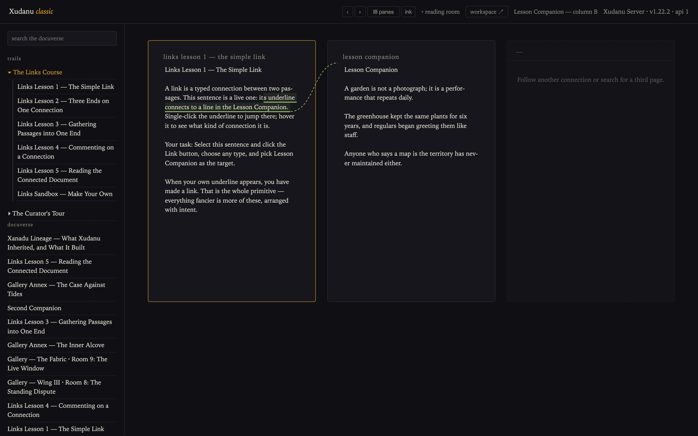

# The 1972 reading interface, alive at last

Status: essay (canonical) · Date: 2026-11-23 · Also readable on Medium, which carries the link back here.

*Fifty years later, the parallel-pages reading machine actually runs.*

---

Start with a drawing.

1972: pen and ink, technical-drafting register, two pages sitting
side by side — and lines drawn *between* them. Not arrows in a
flowchart, not a diagram *about* documents. The lines are the
reading. Each one joins a passage on one page to a passage on the
other, and both ends are real text you can stand at. A few pages,
a web of ink between them, everything visible at once.

That drawing is Ted Nelson's sketch of what reading would look
like in the literature system he was designing — the project that
became Xanadu. You have seen its descendants everywhere and the
thing itself almost nowhere. (The original still lives on
[his own site](https://xanadu.com/xUniverse-D6.html) — the
drawing, and the cheerful photo of its cardboard mock-up.)
Because here is the strange part:
fifty-plus years of "the future of reading," and almost nobody
shipped the posture in that drawing. Not a museum recreation of
it. The actual thing: pages in parallel, connections drawn as
lines between the passages they join, running in a browser, today.

## What the drawing specifies

Read it the way a designer reads a spec, because it is one.

**Documents in parallel.** Not one page replacing another — pages
*beside* each other. Reading is not navigation; it is standing in
one place while being able to see the other place. The unit of
the interface is not the page but the *spread*.

**Connections as geometry.** A link is not an underline that
hides its destination until you commit. It is a line with two
ends, and you can see where it goes before you go there. The
shape of the lines is information: this passage is disputed by
three people, this quotation is used in five places, this
argument has one answer and it is over there.

**Both ends live.** The line points from passage to passage —
not to a page, to the *passage*. And it exists at both ends. If
you are standing at the far end, you can see everything pointing
at you. Nothing connects to you silently.

**The words carry their history.** Who wrote this passage, quoted
in someone else's document? The drawing assumes you can know —
and not via a caption someone typed, but because the system
itself keeps track.

That is the whole spec. No gadget thinking, nothing about
hardware. It is a claim about the *posture of reading*.

## What we shipped instead

You know what shipped. One page at a time. Links as styled text
that hides its destination until you hover, if you think to
hover, and the destination is a whole page anyway, not a passage.
Backlinks — the both-ends-alive part — as a list at the bottom of
the page, if the site bothers, generated by a search engine that
knows the shape and shows you none of it. Parallel reading
improvised as tabs: the browser's apology for a spread.

None of that disproved the drawing. It just left it on the desk.

(Why it stayed on the desk is a longer story than this essay —
and a different one. This essay is about the desk being cleared.)

## The walking tour

Here is what I can now show you, and why this essay exists. I
work on Xudanu, an independent, open-source system built in the
Xanadu lineage — its backend is a translation of the project's
1999-released source code, extended since. It is live. And its
front door was built to answer one question: *what does the 1972
drawing feel like to read in?*

You open the door. No login; reading is free and anonymous. The
first thing you notice is the register: paper and ink, hairline
rules, typography that behaves like a well-set book. There is a
reading room, a lobby of exhibits — a *Gallery of Unusual
Connections* — and a tour you can take. Underlines everywhere.
That is the interface talking: every underline is a live
connection with two ends.

You click one.

The far end does not replace your page. It opens *beside* it — a
second column — and a line is drawn across the spread from the
underlined passage to the passage it connects to. The line is the
one from the drawing. It has weight, it has a lane (connections
stack without hiding each other), and if you hover the underline
it names its kind, because connections are *typed*: this one is
a comment, this one a disagreement, this one a quotation, this
one a see-also. The type is printed on the connection. Reading a
contested passage, you can see the shape of the contest.

Follow enough connections and a third column opens. Your spread
grows. This is the part no screenshot prepares you for: reading
stops feeling like flipping and starts feeling like *moving
around a place*.

Quotations get boxes. When a document quotes another, the quoted
words appear inside a fine rectangle — a window onto the original,
not a copy of it. The box carries a small tab naming its source,
and the tab opens the source beside you, so you can stand in both
places at once. If the words drift out of alignment with their
origin, the system *shows* it rather than silently lying. Anyone
who says a map is the territory has never maintained either — but
these maps are pinned to their territory, and stay pinned.

That aphorism, by the way, is not mine. It is from a document
inside the system — the *Lesson Companion*, a page of short,
stubborn lines that exists partly so the reading room has
something worth connecting to. Its sentences are the far ends of
many of the room's underlines. "A garden is not a photograph; it
is a performance that repeats daily." "The greenhouse kept the
same plants for six years, and regulars began greeting them like
staff." You read the Companion, you click a line elsewhere that
points at one of its lines, and the beam takes you there. The
aphorisms are load-
bearing in the most literal sense an interface can offer.

And the words carry their history, as specified: put your cursor
over any passage and the margin shows who wrote it — authorship
per span, kept by the system, not asserted by a byline. Documents
keep their editions; a reader can step back to the previous
version and return.

There is more — curated trails through the corpus, a skin for
those who prefer the screen's native black — but the tour above
is the drawing. Spread, lines, boxes, signatures.

## Unfinished, not impossible

For decades the 1972 drawing has been filed under *beautiful,
impossible* — the artifact of a vision that could not be built.
The filing is wrong in one quiet way: it was never only a
mockup. It was a reading posture, precise enough to implement,
waiting on implementation. It is implemented now — not by recovering a
mockup's look, but by building the machinery that makes the look
honest: the lines are drawn between real passages because the
links really are between passages; the boxes really are windows
because the system really does have one copy with many views; the
signature in the margin really is the system's record.

A reading interface is a claim about what reading *is*. The 1972
drawing claims reading is connective, parallel, visible, and
accountable. For the first time in a long time you can open a
browser and live inside that claim for five minutes — walk the
gallery, follow the beams, stand in both places at once — and
decide for yourself whether it feels like the future or just like
reading, done right.

Xudanu is an independent project — not affiliated with, endorsed
by, or sponsored by Ted Nelson or Project Xanadu; the trademark
belongs to its holders, and the lineage is acknowledged with
gratitude, not claimed as authority.

The door is open: **https://xudanu.com**
