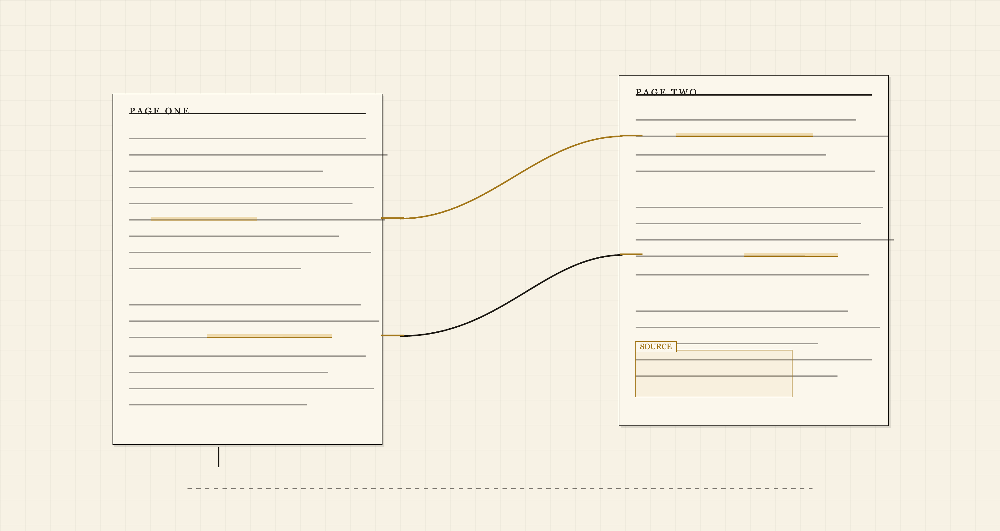

# Whatever happened to Project Xanadu?

Status: essay (canonical) · Date: 2026-11-19 · Also readable on Medium, which carries the link back here.

*The hypertext dream that didn't die.*

---

You have felt the problem, even if you never had a word for it.

An article you loved is gone — the domain lapsed, the page moved,
and the link that promised it now points at nothing. A quote you
screenshotted has no way back to its source; you own a copy of
the words and none of the thread. You publish something and have
no idea who is pointing at it, because on this web, links point
and targets stay silent. Connections rot. Copies drift. Nobody
is home.

This was all foreseen, and it was all designed against — starting
in 1960.

## The man before the word

In 1960, a twenty-something American named Ted Nelson started a
project he would describe, decades later, as the one thing he
never finished and never abandoned. He was thinking about writing
on screens — this is before screens were ready for it — and he
came to a conviction that sounds obvious now and was radical
then: that the real subject was not documents but *connections
between documents*, and that those connections deserved to be
first-class citizens of the writing system itself.

He coined a word for it: **hypertext**. The term first appears in
print in his 1965 paper "A File Structure for the Complex, the
Changing, and the Indeterminate" — delivered at that year's ACM
national conference — though by Nelson's own account the word was
coined in 1963 and the ideas were years older still. He named the
project Xanadu, after the pleasure-dome in Coleridge's "Kubla
Khan": a fragment of a vision, half dream, half monument, famously
never completed. The name was chosen with a wink. It turned out
to be more accurate than anyone wanted.

Nelson was standing, self-consciously, on older shoulders —
Vannevar Bush's 1945 Memex essay "As We May Think" had already
imagined a scholar's desk of linked microfilm. But Bush had
imagined a private memory machine. Nelson wanted literature
itself — a public, connected, permanent system for what people
write to each other.

## What it promised

Strip away the decades of legend and the design rests on a
handful of commitments, each one plain enough to say in a
sentence.

**Every link points both ways.** A connection between two
passages is visible from both ends. Publish something and you can
see everything that points at you — not as a favor granted by a
search engine, but because the system is built that way. Nothing
links to you secretly; nothing links to you silently.

**Quotation without copies.** Nelson's most famous idea — he
called it **transclusion**: the same content, used in many
places, but *living in only one*. When you quote in this system
you open a window onto the original text. The words appear in
your page, but they are not a copy that will drift out of date;
they are the thing itself, seen from where you stand. If the
original is corrected, every window onto it corrects too.

**Connections that cannot break.** Links attach to *passages*,
not to page filenames, and the addressing scheme was designed so
that a connection survives editing. The sentence you pointed at
moves within the document, the document is revised, the passage
is restructured — and the connection follows its words. Link rot,
designed out from the start.

**Documents in parallel.** Not one current version with the past
discarded, but editions standing side by side, connections
visible between the passages of one and the passages of another.
The 1972 sketches of this posture — pages in parallel columns,
lines drawn between connected passages — still look like
something the web never shipped.

**Quote freely, pay automatically.** The economic layer,
"transcopyright": quote anything, and rights-holders are paid
micropayments per view through the quotation chain. This is the
piece that has aged most strangely — and the piece most later
builders, honestly, drop. (The system this essay ends at drops
it too, on a simple design rule: the server never touches
money.)

None of this required smarter computers than the web eventually
had. It required a different *shape* of document — and that is
what Xanadu spent its decades designing.

## The long road

The project's history has been told as tragedy, farce, and
warning, depending on the decade. In the 1970s Nelson published
the movement's twin bibles, *Computer Lib / Dream Machines*,
self-published and evangelical. Through the early 1980s a core
design team iterated the deep architecture — the data model,
the addressing, the swirling, general solution. In 1988 the
project landed real institutional backing: Autodesk, the CAD
software giant, took Xanadu in and funded it. In 1992, Autodesk
set it back out, and the code was rewritten once more in
Smalltalk.

Then came 1995, and the folklore hardened. The Web — Tim
Berners-Lee's CERN creation, shipped in 1991 — was eating the
world with the *simple* version of the idea: one-way links to
whole pages, copies by default. That June, Wired ran Gary Wolf's
"The Curse of Xanadu" — a long, withering profile of Nelson and
the project. The verdict of the era stuck: Xanadu became the
textbook example of vaporware — the grand design that never
shipped, defeated by its own grandeur.

There was truth in it and it wasn't the whole truth. The web had
won by shipping, and it shipped a fraction of the vision. But
the project never ended. Through the late nineties Nelson and a
small group continued, now in Japan, and in 1999 they did
something quiet and enormous: they **released the source code**
of the project's mature backend — the system by then called
Udanax Gold — under the Xanadu X11 license, a permissive
open-source license. Free to read, free to use, free to build on.

And there it sat, largely unnoticed, for a very long time.

## The ideas kept leaking out

Here is the strange part: you already use Xanadu's ideas every
day — in degraded, partial forms that keep being reinvented
because the underlying needs never went away.

Wikipedia's "what links here" is a backlink, bolted on. Blog
trackbacks were backlinks, worse. The note-taking tools of the
last decade — Roam, Obsidian and their descendants — built their
whole appeal on bidirectional links, one of Xanadu's 1963
commitments. Embeds and iframes gesture at transclusion but
deliver copies in disguise. Annotation overlays try to add the
connection layer the web never had. The design writer Maggie
Appleton, in her essay "The Pattern Language of Project Xanadu,"
has catalogued how these patterns keep resurfacing across the
modern web in half-realized forms — worth reading precisely
because the patterns she lists are the ones the web keeps
reinventing badly.

The fragments won. The whole never shipped.

## So — whatever happened to it?

Three things, none of them the folklore answer.

Nelson is alive, in his late eighties, and still publishing —
the project's founder outlived its obituary by decades. The
ideas won in fragments while the whole became a legend. And the
code is public: the 1999 release is still there for anyone to
read, and it is not a sketch — it is years of deep design,
distilled into a working system that implements the commitments
above: two-way connections, transclusion, unbreakable links,
documents in parallel.

Which raises the obvious next question, and it is the reason
this essay exists: *what does that actually look like, running?*

I'm one of the people who went back to the source. Over the past
years I translated the 1999 Udanax Gold codebase into a modern
systems language and built on top of it — an independent,
open-source project called Xudanu, which is where the quotation
system above drops the micropayment layer (the server never
handles money) and keeps everything else. It is live now, and
its front door was built to answer exactly this essay's
question: you open it and you are *reading in the 1972 posture*
— parallel pages, visible connections drawn as beams between
the passages they join, quotations that are windows onto their
originals, each passage carrying the signature of whoever wrote
it.

Xudanu is an independent project — not affiliated with, endorsed
by, or sponsored by Ted Nelson or Project Xanadu; the trademark
belongs to its holders, and the lineage is acknowledged with
gratitude, not claimed as authority.

Whatever happened to Project Xanadu? It happened slowly, it is
still happening, and for the first time in a long time you can
walk through a door and read inside the design instead of
reading about it.

The door is open: **https://xudanu.com**
